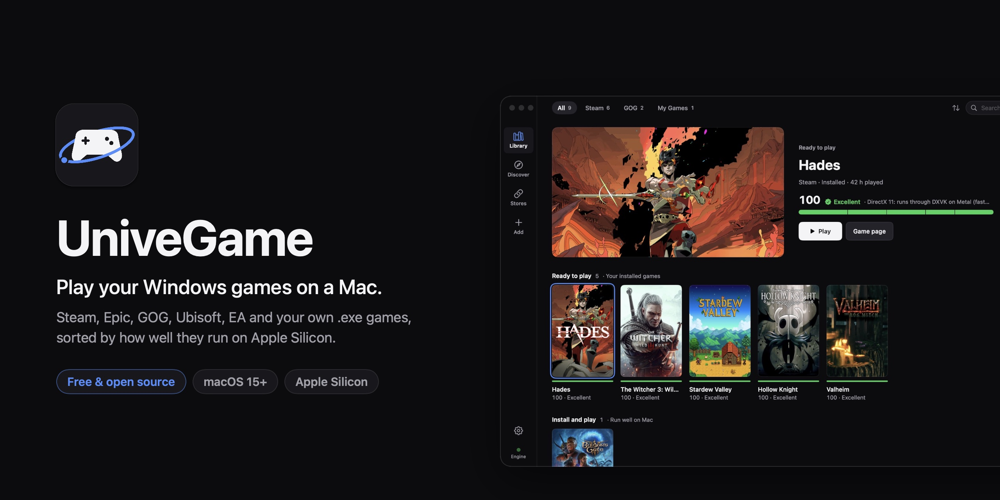
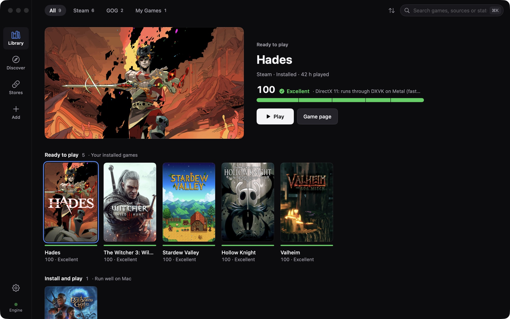
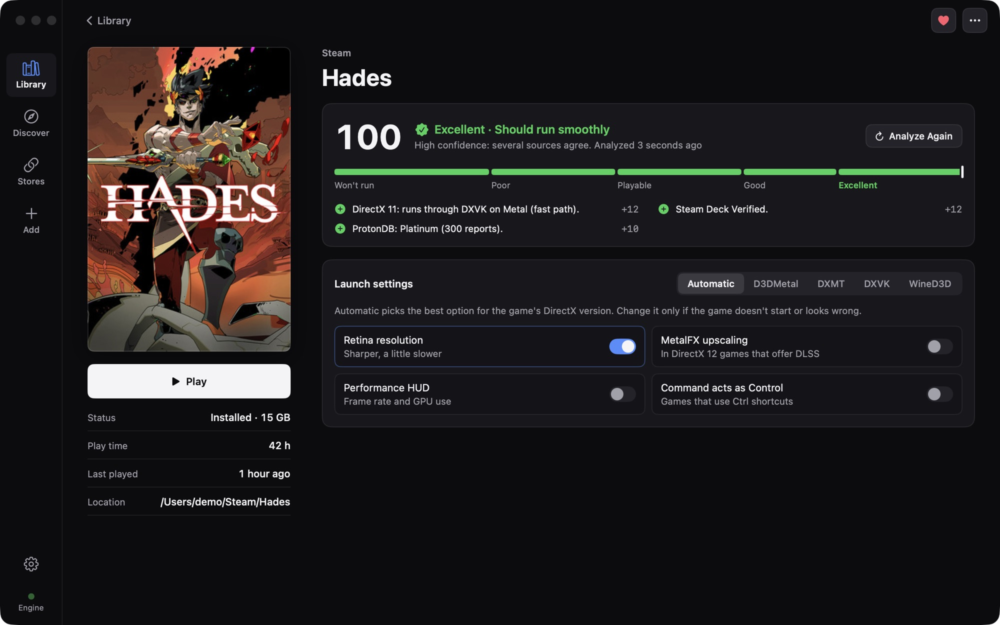
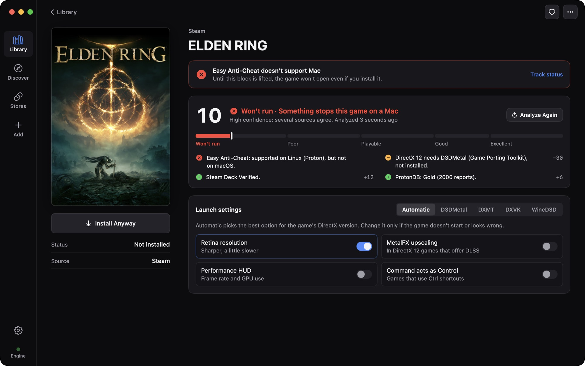
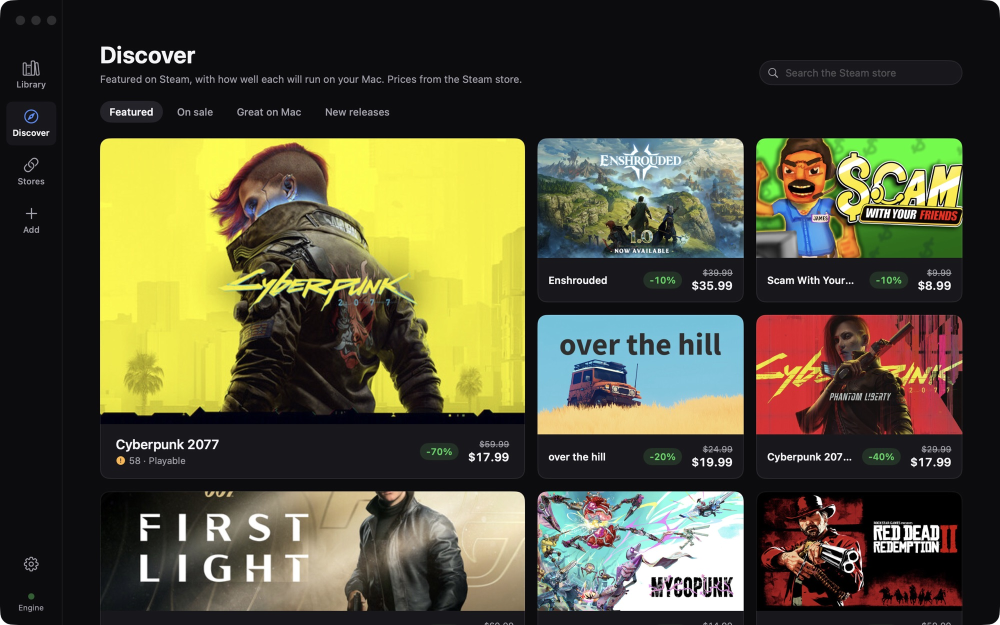
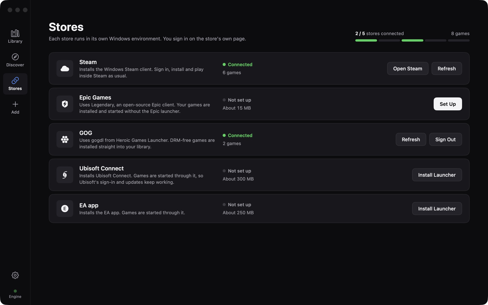
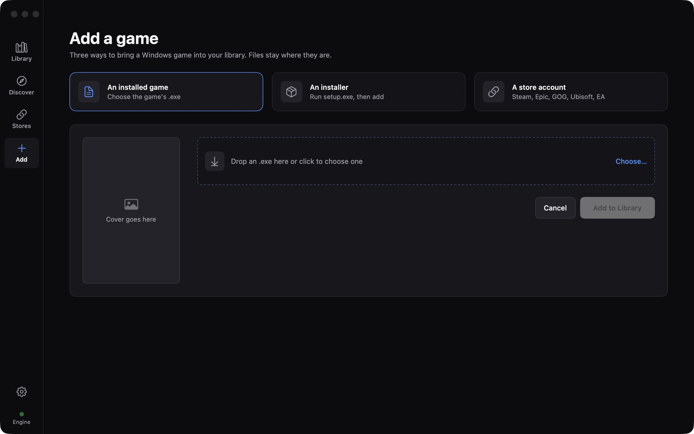
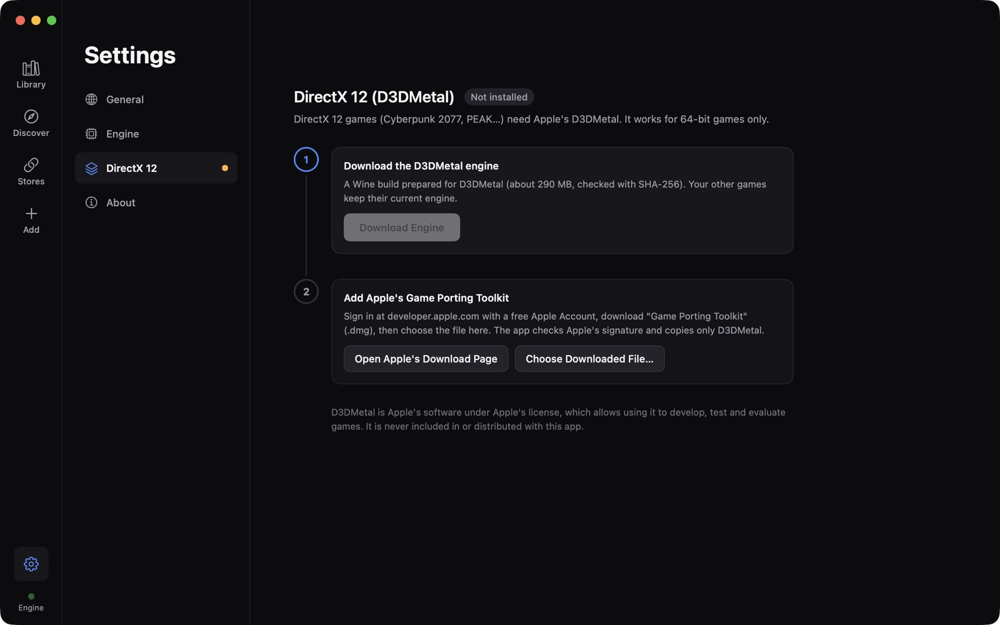

<p align="center">
  
</p>

<h1 align="center">UniveGame</h1>

<p align="center">
  <strong>Play your Windows games on a Mac.</strong><br>
  A free, open-source game launcher for Apple Silicon. Steam, Epic Games, GOG, Ubisoft Connect, EA app and your own
  <code>.exe</code> games in one library, sorted by how well each one will run on your Mac.
</p>

<p align="center">
  <a href="https://github.com/MuratDugan/UniveGame/releases/latest"></a>
</p>

<p align="center">
  
  
  
  
  
</p>

<p align="center">
  <a href="#features">Features</a> ·
  <a href="#download">Download</a> ·
  <a href="#how-the-compatibility-score-works">Compatibility score</a> ·
  <a href="#build-from-source">Build from source</a> ·
  <a href="#faq">FAQ</a> ·
  <a href="README.tr.md">Türkçe</a>
</p>

---

UniveGame runs Windows games on macOS through [Wine](https://www.winehq.org), [DXVK](https://github.com/doitsujin/dxvk)
and Apple's D3DMetal. You don't set up Wine prefixes or read forum threads first: you connect your stores, and the
library tells you which games are ready to play, which ones are worth installing and which ones won't open on a Mac,
with the reason. It costs nothing and it never will.

Setup files are covered too: if an installer won't run under Wine, UniveGame unpacks it directly (Inno Setup, NSIS,
MSI, 7z, ZIP, RAR, CAB) and you pick the game's program.

<p align="center">
  
</p>

## Features

- **One library for every store.** Steam (owned games too, not only installed ones), Epic Games Store via
  [Legendary](https://github.com/derrod/legendary), GOG via gogdl, Ubisoft Connect and the EA app, plus any Windows
  `.exe` you already have.
- **Shelves sorted by how well games run.** *Ready to play*, *Install and play*, *Hard on Mac* and *Not analyzed yet*,
  so the first thing you see is what you can play tonight.
- **A compatibility score for every game.** 0–100, a tier from Excellent to Won't run, a confidence level and every
  reason behind it: DirectX version, 32/64-bit, game engine, anti-cheat, Steam Deck verdict, ProtonDB reports.
  [More below](#how-the-compatibility-score-works).
- **Installers that work like on Windows.** Drop a `setup.exe` or `.msi` on the window. It runs in its own Windows
  environment, paths like `C:\Games\...` just work, and UniveGame finds the game's launcher when the installer closes.
- **DirectX 9 to 12.** DXVK for DirectX 10/11, WineD3D for older games, and Apple's D3DMetal for DirectX 12 games
  (set up from your own Game Porting Toolkit download in two steps).
- **Per-game launch settings.** Graphics backend, Retina resolution, MetalFX upscaling, the Metal performance HUD and
  Command-as-Control.
- **Covers found for you.** Add a game by hand and UniveGame looks up its cover and artwork by name, in your language.
- **Discover.** Steam's featured games and deals in a grid, with Mac scores for games you own.
- **English and Turkish**, switchable without restarting. Made for macOS with SwiftUI: dark, quiet, keyboard-friendly.

<table>
  <tr>
    <td width="50%"></td>
    <td width="50%"></td>
  </tr>
  <tr>
    <td></td>
    <td></td>
  </tr>
  <tr>
    <td></td>
    <td></td>
  </tr>
</table>

## Download

1. Download the latest **UniveGame-x.y.z.dmg** from [Releases](https://github.com/MuratDugan/UniveGame/releases/latest).
2. Open it and drag UniveGame to Applications.
3. Start it, connect a store or drop a Windows game on the window.

The app is signed with a Developer ID and notarized by Apple, so it opens without Gatekeeper warnings. It needs
**macOS 15 or later on an Apple Silicon Mac** (M1, M2, M3, M4) and downloads its Wine engine (about 140 MB) the
first time it runs.

## How the compatibility score works

Press **Analyze** on a game page, or **Analyze Whole Library** in the library menu. UniveGame weighs:

| Source | What it tells |
|---|---|
| The game's own files (when installed) | PE headers and imports: 32/64-bit, DirectX 8/9/10/11/12, OpenGL, Vulkan; the engine (Unity, Unreal 4/5, Source…); anti-cheat drivers, launchers, .NET, Media Foundation, Chromium |
| Steam's local cache | Steam Deck verdict and its reason, macOS version, release year |
| Steam store | DirectX version from the system requirements, or a guess from the listed graphics card |
| [ProtonDB](https://www.protondb.com) | How the game runs under Wine on Linux, from player reports |
| [AreWeAntiCheatYet](https://areweanticheatyet.com) | Anti-cheat type and status, matched by Steam or Epic ID |

The weights are tuned for macOS rather than Linux. Kernel-level anti-cheat (Easy Anti-Cheat, BattlEye, Vanguard…) is
always *Won't run*, even when it's allowed on Linux. DirectX 11/10 is fast through DXVK, DirectX 12 needs D3DMetal,
DirectX 9 goes through OpenGL and is slower. Reports keep their evidence, so scores are recomputed offline when the
rules improve. The score is an estimate, not a promise.

## Build from source

Requirements: macOS 15+, Apple Silicon, **Xcode 16 or later** (SwiftUI's macros ship with Xcode, not with the
Command Line Tools).

```bash
git clone https://github.com/MuratDugan/UniveGame.git
cd UniveGame
scripts/bundle.sh debug                      # builds build/UniveGame.app
open build/UniveGame.app
open -n build/UniveGame.app --args --demo    # try the interface without engines or accounts
swift test                                   # unit tests
```

Swift Package Manager fetches the engine library, [UniveEngine](https://github.com/MuratDugan/UniveEngine), pinned
to an exact commit. Developer flags: `--section discover|stores|add|settings|dx12`, `--open steam:1145360`,
`--install <setup.exe>`, `-appLanguage en|tr|system`.

Releases are built with `scripts/release.sh` (Developer ID signing, hardened runtime, notarization, stapling, DMG).
The version lives in [`VERSION`](VERSION). Design specs and assets are in [`design/`](design/README.md).

## FAQ

**Is UniveGame free?**
Yes. It's free, has no account, no ads and no telemetry, and the source code is under the Apache 2.0 license.

**How is it different from CrossOver, Whisky or Parallels?**
CrossOver is a paid product. Whisky is no longer maintained. Parallels runs a whole Windows virtual machine. UniveGame
is a free, open-source launcher built around your game library. It connects your stores, scores every game for the Mac,
and runs each one through Wine, DXVK or D3DMetal without a Windows license or a virtual machine.

**Can I play Steam games on a Mac without Windows?**
Yes. UniveGame installs the Windows Steam client in its own environment. You sign in to Steam as usual, and your owned
games appear in the library with their Mac scores.

**Does it support DirectX 12 and Apple's Game Porting Toolkit?**
Yes. DirectX 12 games run through D3DMetal, which comes from Apple's Game Porting Toolkit. Apple doesn't allow
redistributing it, so you download the toolkit from Apple yourself. Settings › DirectX 12 then copies D3DMetal from
that download after checking Apple's signature.

**Why won't some games run?**
Mostly because of kernel-level anti-cheat (Fortnite, Apex Legends, PUBG, Valorant…), which doesn't run under Wine on
macOS. UniveGame shows this on the game page before you spend time downloading.

**Is it safe for my accounts?**
Store sign-ins happen on the store's own page or in its own client; UniveGame never sees your password. Running games
through Wine can conflict with some games' terms, and anti-cheat can flag it. Read the in-app disclaimer, and keep
backups of important saves.

## Roadmap

- **UniveEngine.** The engine now lives in its own repository, [UniveEngine](https://github.com/MuratDugan/UniveEngine),
  with its own engine list and releases (including the complete source of every Wine build). Next: engines built in
  CI from pinned sources, newer Wine and DXVK.
- More stores and better per-game fixes.
- Community compatibility reports from inside the app.

Ideas and game reports are welcome in [Issues](https://github.com/MuratDugan/UniveGame/issues).

## Credits and license

UniveGame is released under the [Apache License 2.0](LICENSE). See [NOTICE](NOTICE) for attributions.

It stands on the work of others:

- [UniveEngine](https://github.com/MuratDugan/UniveEngine), our engine, derived from
  [MacadeKit](https://github.com/abduzeedo/mapc-engine), the open-source core of [MaPC](https://mapc.games)
  (Apache 2.0): Wine engines, environments, graphics backends and store integrations.
- [Wine](https://www.winehq.org) (LGPL 2.1+), [DXVK](https://github.com/doitsujin/dxvk) (zlib),
  [MoltenVK](https://github.com/KhronosGroup/MoltenVK) (Apache 2.0), Wine Mono and
  [Gcenx's macOS Wine builds](https://github.com/Gcenx/macOS_Wine_builds).
- [Legendary](https://github.com/derrod/legendary) and [gogdl](https://github.com/Heroic-Games-Launcher/heroic-gogdl)
  (GPL 3.0), run as separate programs.

UniveGame is not affiliated with or endorsed by Valve, Epic Games, GOG, Ubisoft, Electronic Arts, Apple, CodeWeavers
or Steale LLC. Steam, Mac, macOS, Metal and other names are trademarks of their owners, used only to say what
UniveGame works with. The software is provided as is, without warranty.
